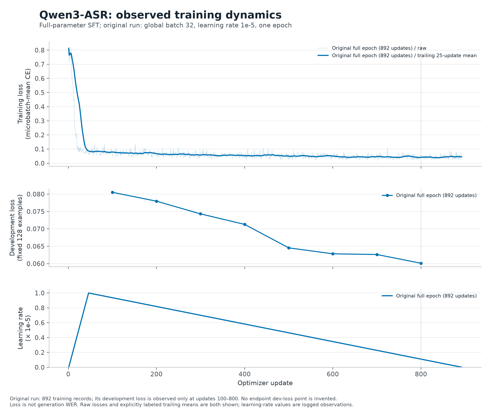
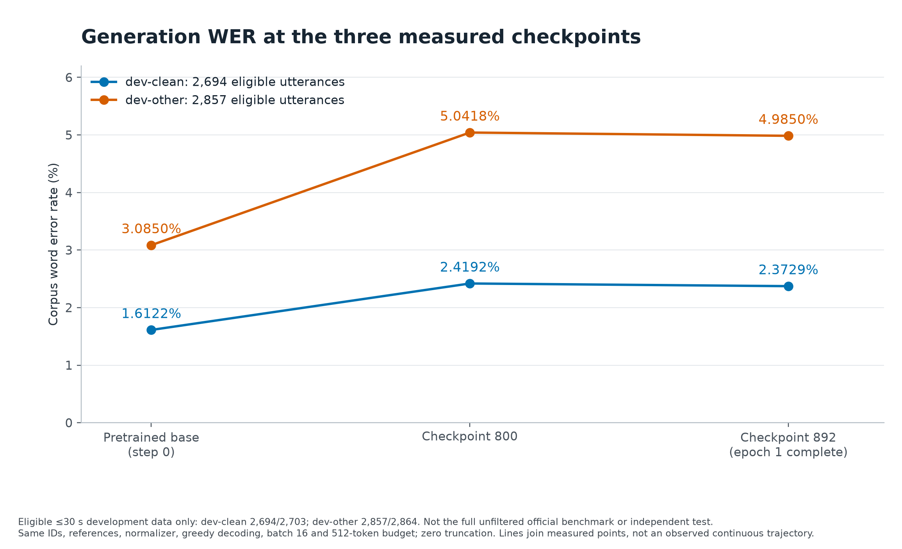
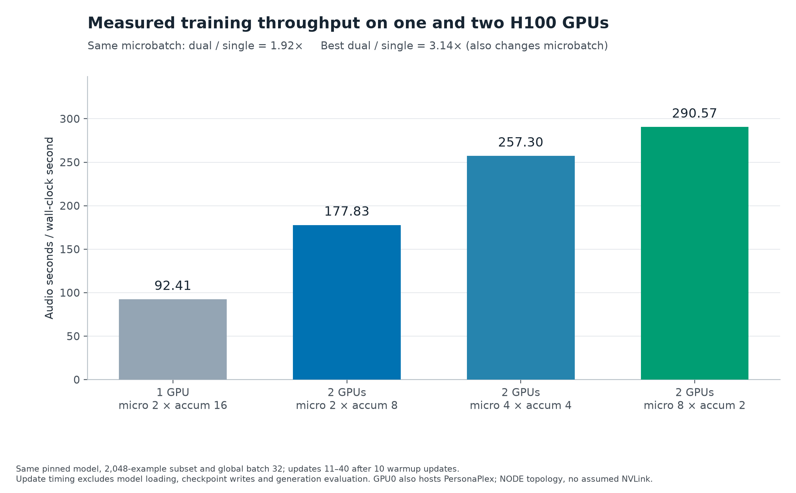

# 可复现ASR实验图片

三组图直接读取现有本地收据；PNG用于查看，SVG保留可编辑文本，PDF用于矢量导出。没有重跑模型或评测，也没有用图像生成模型绘制数据。

## 重新生成

在仓库根目录运行：

```bash
.venv/bin/python -m pip install -r requirements-plots.txt
.venv/bin/python scripts/plot_experiment_results.py
```

本次环境为matplotlib 3.11.2、Python 3.12.15；完整绘图依赖固定在`../../requirements-plots.txt`。
总命令、脚本SHA256和每个输出的SHA256见[figure_manifest.json](figure_manifest.json)。输出已逐图视觉检查，修复了标题重叠及step892刻度裁切。

## 图及其口径

### Observed training loss, development loss and learning rate



[PNG](training_dynamics.png) · [SVG](training_dynamics.svg) · [PDF](training_dynamics.pdf) · [来源与hash](training_dynamics.metadata.json)

Original run: 892 training records; its development loss is observed only at updates 100–800. No endpoint dev-loss point is invented. Loss is not generation WER. Raw losses and explicitly labeled trailing means are both shown; learning-rate values are logged observations.

| 输入源文件 | SHA256 |
|---|---|
| `reports/qwen-campaign-20261022-a/main-epoch1/metrics.jsonl` | `a7163b884ddf50e99ead921b518c0218aa966ac8733875bc0a8aab2483d07572` |
| `reports/qwen-campaign-20261022-a/main-epoch1/run.json` | `df89c47dd1273ce7872bced73c17e2a0b193aa32cea0d4918c428f837b22d758` |

### Eligible-development generation WER by checkpoint



[PNG](checkpoint_wer.png) · [SVG](checkpoint_wer.svg) · [PDF](checkpoint_wer.pdf) · [来源与hash](checkpoint_wer.metadata.json)

Eligible ≤30 s development data only: dev-clean 2,694/2,703; dev-other 2,857/2,864. Not the full unfiltered official benchmark or independent test. Same IDs, references, normalizer, greedy decoding, batch 16 and 512-token budget; zero truncation. Lines join measured points, not an observed continuous trajectory.

| 输入源文件 | SHA256 |
|---|---|
| `reports/qwen-campaign-20261022-a/evaluation/baseline-dev-clean/predictions.metrics.json` | `504a67be4f3f64393c0c49e36dc2a9c2994dc38bf5136b7c9d76fa9026d72fd7` |
| `reports/diagnosis/checkpoint800/dev-clean/predictions.metrics.json` | `6b706d7ced282eb3ee0a7efd2ec3ce2c6d8939d9aaf18fc5aa89044744e4670e` |
| `reports/qwen-campaign-20261022-a/evaluation/final-dev_clean/predictions.metrics.json` | `650a7b1b235cbdeec36568734dcae6f2cc36b13a2d6e10e48134e98ed5dfd203` |
| `reports/qwen-campaign-20261022-a/evaluation/baseline-dev-other/predictions.metrics.json` | `d77df8e4454ca42ac65fd568df83d8f054f8c1fd46c128e03c7b10b176714b8c` |
| `reports/diagnosis/checkpoint800/dev-other/predictions.metrics.json` | `7ddf4296eaf0877180d12905ba5cf9d34054122eaa6e38d3324b1aef7d585145` |
| `reports/qwen-campaign-20261022-a/evaluation/final-dev_other/predictions.metrics.json` | `e120bcf8fe2beda540e7721ff1a4d2f545492f81fbcce0f36fb9de6103d28e11` |

### Controlled H100 throughput measurements



[PNG](gpu_throughput.png) · [SVG](gpu_throughput.svg) · [PDF](gpu_throughput.pdf) · [来源与hash](gpu_throughput.metadata.json)

Same pinned model, 2,048-example subset and global batch 32; updates 11–40 after 10 warmup updates. Update timing excludes model loading, checkpoint writes and generation evaluation. GPU0 also hosts PersonaPlex; NODE topology, no assumed NVLink.

| 输入源文件 | SHA256 |
|---|---|
| `reports/qwen-campaign-20261022-a/experiment_results.json` | `7b0985c4e0561d36c7a9378c4fa769db10a5c9ca3b1c955b5e1cb98f25b6e008` |
| `reports/qwen-campaign-20261022-a/E1-single-b2/run.json` | `362f5ce14e334346eac158452051b9dc37888dc08ba52269a91634c11930d586` |
| `reports/qwen-campaign-20261022-a/E1-single-b2/benchmark_summary.json` | `7619c0df12133677b6c7c5c45062b3c670d36cbee00837744ea8952c52d42ba8` |
| `reports/qwen-campaign-20261022-a/E2-dual-b2/run.json` | `8917f53fb725e20a7e70aef7ddeeb267456f87ec01fd0906bdbd55d9e724ce40` |
| `reports/qwen-campaign-20261022-a/E2-dual-b2/benchmark_summary.json` | `2215e61d9496c145351582d7bbcb0b48882a5616fad14aea428488797fa53a51` |
| `reports/qwen-campaign-20261022-a/E3-dual-b4/run.json` | `acc176e2c933dcba1d7441162134b0498394a1dc389af82e23f670fdb8653172` |
| `reports/qwen-campaign-20261022-a/E3-dual-b4/benchmark_summary.json` | `2bce7cf488e8740d3d3f046e4c86a9f416997bfe902e433ddea719820d88d11c` |
| `reports/qwen-campaign-20261022-a/E4-dual-b8/run.json` | `1a67f3c578d7a48a62cd178a98a28bb7d883a053905ee801d5948ce3bae5c4f6` |
| `reports/qwen-campaign-20261022-a/E4-dual-b8/benchmark_summary.json` | `52fdb216d80ed85a8c3d9966ceb725d9deb6c663de342d8ec41e03adabe7064d` |

## 后续添加early100曲线

待主代理同步独立run的实际`metrics.jsonl`后，替换下例目录；当前尚未加入early100新数据：

```bash
.venv/bin/python scripts/plot_experiment_results.py \
  --additional-run "early100=reports/实际early100-run目录" \
  --output reports/figures/with-early100
```

新run仅按已存在的step/loss/LR/dev-loss点叠加到训练图；它不会由授权、计划或空目录生成曲线。WER图仍只使用已保存的原始/800/892指标，新checkpoint的WER需另行同步真实生成评测结果。

训练loss采用日志中的microbatch-mean CE；浅线是每步原值，深线是明确标注的trailing 25-update均值（开头不足25步时使用现有窗口）。该平滑不改变原数据，也不能证明识别改善。

所有WER均为eligible ≤30s dev，非完整未过滤官方benchmark或独立test；区间统计保存在diagnosis配对报告中，本图不伪造单checkpoint误差条。
