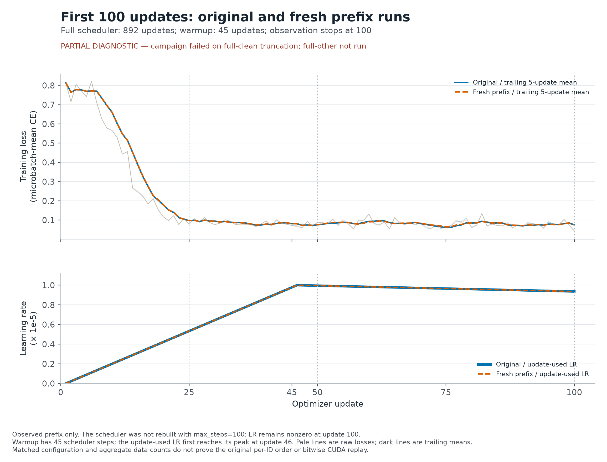
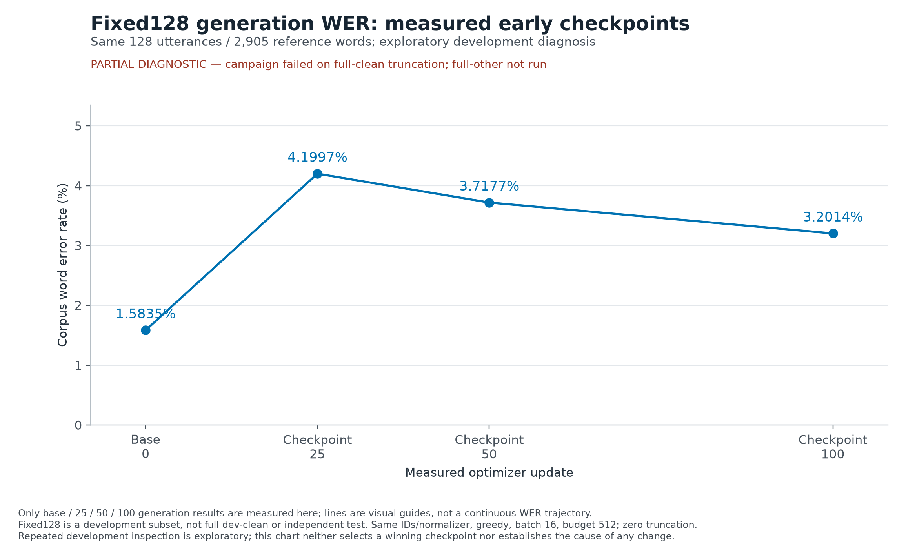

# Early100真实结果图片

诊断部分结果：campaign因full-clean一条512-token截断而failed；full-other未执行。这里只展示已通过的fixed128与完成的100步训练；不接受或绘制full-dev结果。 本目录不修改原三组图与其manifest。

复算（仓库根目录，依赖固定于`requirements-plots.txt`）：

```bash
.venv/bin/python scripts/plot_early100_results.py --early100 reports/early100/run --partial-diagnostic
```

每个图的输入清单/完整SHA256、实际指标摘要和PNG/SVG/PDF输出指纹见同名metadata；脚本和复用helper指纹见`figure_manifest.json`。

## Observed original/new first100 loss and learning rate



[PNG](first100_training.png) · [SVG](first100_training.svg) · [PDF](first100_training.pdf) · [来源/hash](first100_training.metadata.json)

Observed prefix only. The scheduler was not rebuilt with max_steps=100: LR remains nonzero at update 100. Warmup has 45 scheduler steps; the update-used LR first reaches its peak at update 46. Pale lines are raw losses; dark lines are trailing means. Matched configuration and aggregate data counts do not prove the original per-ID order or bitwise CUDA replay.

## Observed base25/50/100 fixed128 WER



[PNG](fixed128_early_wer.png) · [SVG](fixed128_early_wer.svg) · [PDF](fixed128_early_wer.pdf) · [来源/hash](fixed128_early_wer.metadata.json)

Only base / 25 / 50 / 100 generation results are measured here; lines are visual guides, not a continuous WER trajectory. Fixed128 is a development subset, not full dev-clean or independent test. Same IDs/normalizer, greedy, batch 16, budget 512; zero truncation. Repeated development inspection is exploratory; this chart neither selects a winning checkpoint nor establishes the cause of any change.
