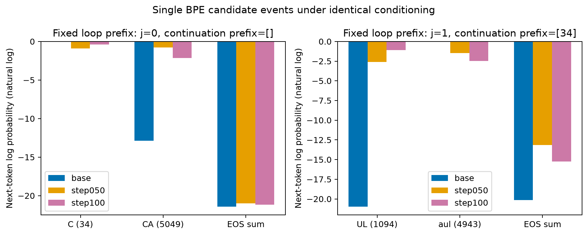
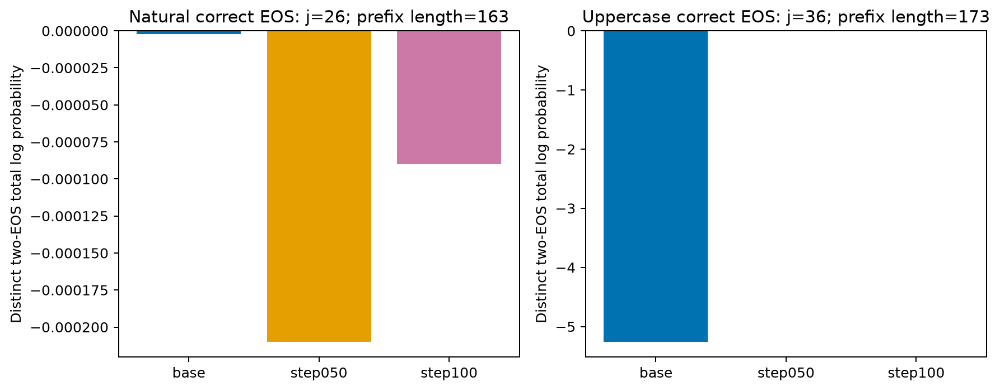
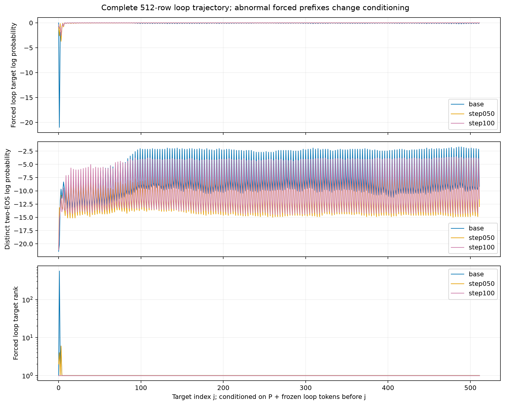

# 数值审计修复与已有矩阵CPU复算

2026-10-26。**修复后独立审计通过全部2,304行／12矩阵；原始失败仍完整保留。** 本阶段使用服务器CPU，新增模型调用、GPU计算、权重读取与训练更新均为0；保持512-token实验身份，没有进入B，也没有改动服务。

## 计划、预算与实际投入

先保存[执行计划](../CPU_NUMERIC_REPAIR_PLAN_2026-10-26.md)，再诊断和修复。三个阶段均只执行一次，无完整重试。

| 阶段 | 上限 | 实测墙钟 | 结果 |
|---|---:|---:|---|
| 原失败行诊断 | 120秒 | 2.333秒 | 精确复现旧概率，并比较稳定算法 |
| 全量派生统计重算 | 600秒 | 109.134秒 | 2,304行、12矩阵完成 |
| 原容差独立审计及跨模型摘要验证 | 600秒 | 17.537秒 | 全部通过 |
| 累计远端CPU阶段 | 1,500秒 | 129.004秒 | 在预算内 |

使用4个CPU线程；旧公式专门用原worker的1线程复现，再用4线程比较候选和reference。资源监控含立即、每5秒及终态采样：审计阶段观测到的最高RSS为2.274GiB，上限8GiB；三阶段监控到的新增分析内容约56.29MiB，上限128MiB；最少盘余量约2,503.82GiB，高于500GiB。原始矩阵没有复制到新分析目录。采样不能证明瞬时峰值；短诊断在5秒间隔内完成，其RSS也不应当作真实峰值。

停止条件包括哈希／shape／token／EOS／因果行映射漂移、非有限值、任一原容差失败、超时或资源超限；均保留失败并停止，不扩预算、不重跑模型。旧失败审计仍记为一次失败；本次是用户另行授权、单独记账的CPU修复与复算。

## 已确认根因

原`row_statistics`使用FP32的`row - logsumexp(row)`。`logsumexp`先把最大logit加回绝对归一化常数，再做相减；FP32舍入丢失了很小的归一化项。真实失败行是`base/generation/j=2`，目标token为`iflower`（ID76773），最大logit为38，其FP32相邻数间距为3.8147e-6。旧公式得到的概率严格复现了原JSON。

| 同一保存行的计算 | 目标概率 | 对独立FP64的绝对误差 | 原1e-6门槛 |
|---|---:|---:|---|
| 原FP32公式／原JSON | 0.9999313354492188 | 1.116753e-6 | 失败 |
| 先减最大值的FP32对照 | 0.9999302625656128 | 4.386948e-8 | 本行通过 |
| 修复后的FP64 fused log_softmax | 0.9999302186961743 | 3.752554e-14 | 本行通过 |

独立FP64 reference为0.9999302186961367；这次单行诊断使用与原审计等价的独立max-shift exp/sum/log计算，末位可能因归约顺序与原审计不同，远小于原容差。[完整诊断](diagnosis.json)保留全部算法、normalizer、entropy、EOS及误差。该证据定位的是**派生统计精度问题**，不能解释或修复模型为何产生CULINARY循环。

生产修复只将派生统计的log_softmax／概率／entropy／EOS运算提升到FP64，并对top2 margin作FP64减法；原始矩阵仍是FP32，token、prefix、原始logit、rank和tie规则不变。源码增加计算精度说明。新回归在修复前复现大公共偏移造成1.956073e-5概率误差，以及有限FP32极值的中间溢出；修复后含现有supervision在内的50项专项测试通过。

## 全量验收与修复前后证据

独立验证器导入**SHA固定的原审计源码**，先核验原worker全部artifact，再选择新的派生JSON；独立FP64算法和所有原容差没有改变。审计对2304×151936完整词表行检查目标／候选／top10概率与logprob、rank、ties、argmax、entropy、margin、两个distinct EOS、NLL、因果行映射和own-trajectory差值；另独立重建跨模型prefix、候选及EOS差值、NLL摘要。

| 全量指标 | 修复后最大绝对误差 | 原容差 |
|---|---:|---:|
| 目标／候选／top10概率 | 1.52434e-13 | 1e-6 |
| 单事件logprob | 1.56319e-13 | 5e-5 |
| entropy | 1.51060e-13 | 5e-5 |
| EOS总概率 | 5.55112e-15 | 1e-6 |
| EOS总logprob | 1.52767e-13 | 5e-5 |
| top2 margin | 0 | 5e-5 |
| own-comparison平均logit差 | 1.13840e-8 | 5e-5 |
| NLL总量 | 1.54934e-11 | 行数×5e-5 |
| rank／tie／argmax／top10 ID | 完全一致 | exact |

[完整独立审计](overlay-independent-audit.json)与[可读审计](overlay-independent-audit.md)保留每项误差、原容差和artifact SHA。旧JSON对比新JSON的独立复核覆盖全部2304行：395行target概率变化超过1e-6，最大变化2.16293e-6；其余列出的目标logprob／EOS总量／entropy变化没有越过各自原门槛。[对比收据](old-new-json-comparison-verification.json)只比较保存的JSON，没有额外计算模型或矩阵。

原A运行的**130文件／1,462,218,349字节**在复算后逐文件SHA及大小全部与原inventory一致；9份冻结源码也未在执行中变化。见[原始证据复核](immutable-after.json)。原运行和失败wrapper未被覆盖；原audit在首个失败行停止，原已验收行数仍为null，不能回写成2304。新overlay通过是独立的后续状态。

## 保存位置与复现入口

- 远端原始run：`/mnt/raid/asr-lab/runs/qwen-token-probability-20261026-gpu0-a`。
- 远端新分析：`/mnt/raid/asr-lab/analyses/token-probability-cpu-20261026-r1`；本目录为完整本地镜像。
- [manifest](recomputed/manifest.json)：12份新derived和3份own-comparison的原／新SHA、CPU运算精度、输入身份；[跨模型比较](recomputed/comparisons.json)和[变化摘要](recomputed/change-summary.json)也有SHA。完整大JSON保存在本地／RAID，不加入Git。
- [原失败与新旧源码](provenance/manifest-before.json)、[本次源码冻结](source-freeze.json)、[修复前回归](regression-before.json)、[修复后测试日志](regression-after.log)。
- `diagnostic/`、`recompute/`、`audit/`分别保存实际命令、开始／结束／退出／清理收据、stdout/stderr、resources.jsonl和进度。接受结果只有最终`overlay-independent-audit.json`；pending不算验收通过。
- 原失败审计工具SHA：`ebc8db219efce0f05db3859976cf0d41834d4cfac2160837cb6418fe8b6e921d`；原统计源码`acc34e…a43b`；修复后统计源码`ed37de…1441`。完整SHA见冻结文件。

实际复算命令及参数完整记录在[recompute/stage.json](recompute/stage.json)，独立审计命令在[audit/stage.json](audit/stage.json)。这些目录只执行一次，不能直接重放；未来若另行授权复算须换独立新目录，并仍指向不可变原矩阵。

## 已验收数据图与解释边界

三张图均在独立审计通过后，从新derived生成，保存PNG／SVG／PDF各一份；[图源SHA](figures/sources.json)绑定九份fixed-trajectory derived及reference。图像已逐张检查。

这些图用于描述同一固定prefix下的条件概率。自然转录与全大写转录都是正确文本；单个BPE候选不是整词概率。强制给定异常循环prefix后，原模型和50步模型也常预测继续，因此不能仅用该prefix下低EOS归因训练；100步在自由生成时进入循环的事实仍由原raw token证明。正确转录prefix下100步仍能给EOS高概率，也不足以证明所有场景终止正常。

**当前到此停止。** 原模型生成、解码和解析证据没有改变；语音重复与总体WER退化的训练根因仍待后续单独设计。没有重跑模型、修改512-token预算、启动B或新增训练；本阶段未查询／操作GPU或服务。
